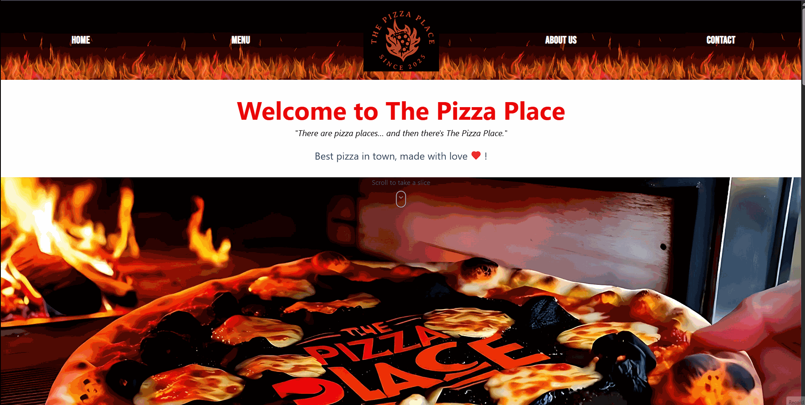
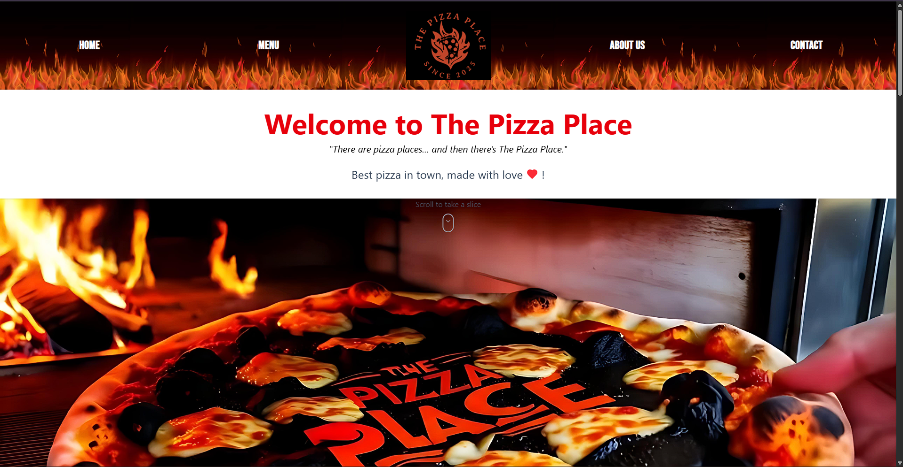
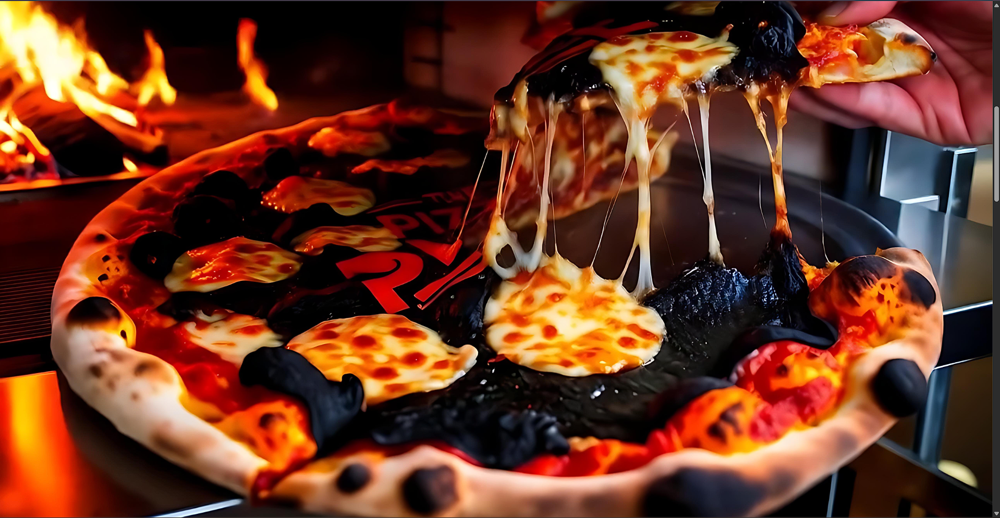
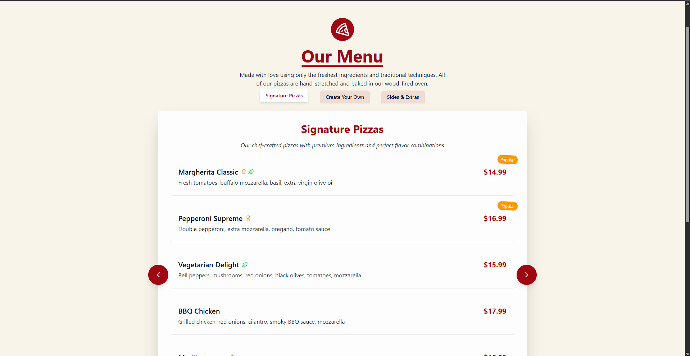
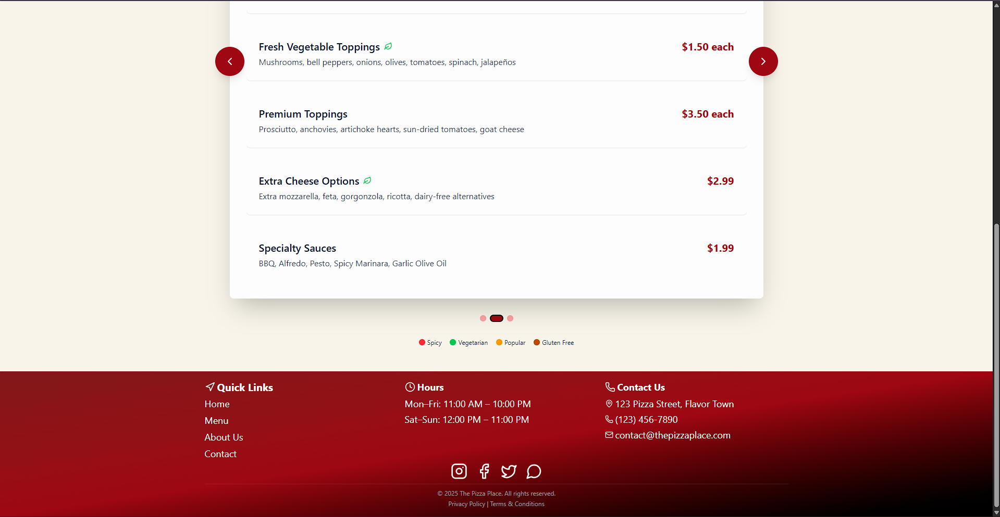
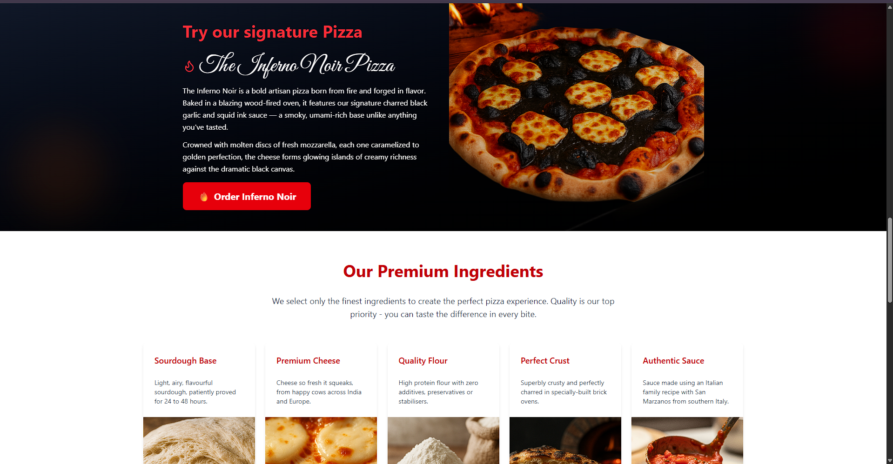
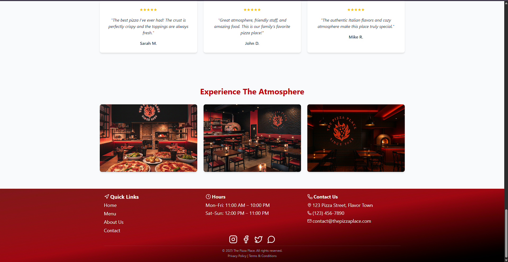
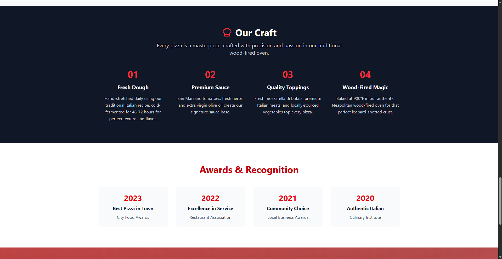
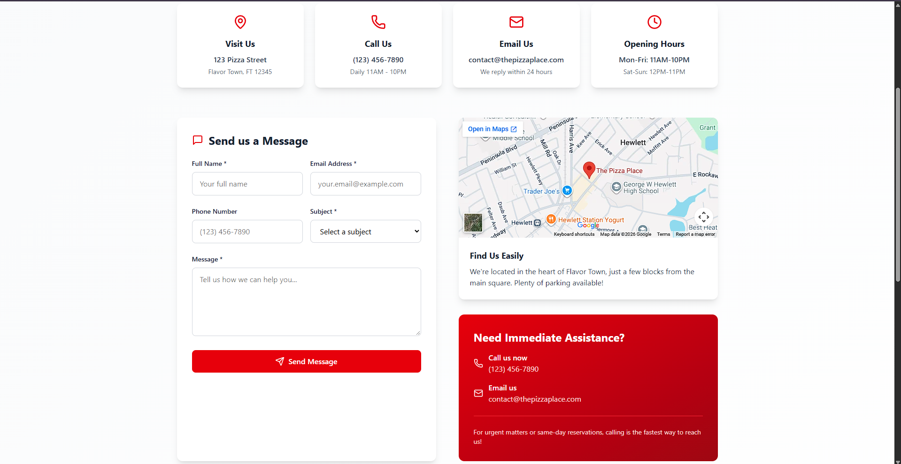

# 🍕 The Pizza Place

A modern, fully responsive multi-page restaurant website built with **React** and deployed on **AWS S3** with a **serverless backend** powered by **AWS Lambda, API Gateway, and DynamoDB**.

This project simulates a real restaurant website with an interactive UI, smooth navigation, and a fully functional contact form that stores user messages in a cloud database.

---

## ✨ Features

* Fully responsive multi-page React website
* Dynamic hero section with scroll-based pizza animation
* AI-generated imagery for menu items and restaurant visuals
* Clean and reusable UI components
* Smooth page transitions using React Router
* Contact form with real backend integration
* Toast notifications for success and error handling
* Serverless backend architecture using AWS

---

## 🖼️ Screenshots & Demo

### 🎬 Animation Demo


### 🏠 Home Page


### 🍕 Hero Section


### 🍽️ Menu




### 🌋 Inferno Pizza


### 🎨 Restaurant Atmosphere


### 👨‍🍳 Craft


### 📬 Contact Form


---

## 🏗️ Architecture

Frontend (React + Redux + Redux-Saga)
⬇
API Gateway (HTTP API)
⬇
AWS Lambda (Node.js)
⬇
DynamoDB (stores contact form submissions)

This architecture ensures a **scalable, serverless backend** without maintaining traditional servers.

---

## 🛠️ Tech Stack

### Frontend

* React
* Redux
* Redux-Saga
* React Router
* Tailwind CSS
* Lucide Icons
* React Hot Toast

### Backend (Serverless)

* AWS API Gateway
* AWS Lambda ( Node.js )
* DynamoDB

### Deployment

* AWS S3 Static Website Hosting

---

## 📁 Project Structure

```
src/
│
├── Components/        # Reusable UI components
├── Pages/             # Page-level components
├── Redux/             # Redux state management
│   ├── Contact/
│   │   ├── actions.js
│   │   ├── reducer.js
│   │   ├── saga.js
│   │   └── types.js
│   ├── rootReducer.js
│   ├── rootSaga.js
│   └── store.js
│
├── App.jsx
├── main.jsx
└── index.css
```

---

## ⚙️ Installation & Setup

Clone the repository:

```bash
git clone https://github.com/yourusername/the-pizza-place.git
```

Navigate to the project folder:

```bash
cd the-pizza-place
```

Install dependencies:

```bash
npm install
```

Run the development server:

```bash
npm run dev
```

---

## 📬 Contact Form Backend

The contact form sends data to an AWS API endpoint:

```
POST /submit
```

The request is processed by:

* **API Gateway** → receives HTTP request
* **Lambda Function** → processes form data
* **DynamoDB** → stores user messages

Stored fields include:

* name
* email
* phone
* subject
* message
* createdAt timestamp

---

## ☁️ Deployment

The frontend is deployed using **AWS S3 Static Website Hosting**.

Build the project:

```bash
npm run build
```

Upload the `dist` folder to your S3 bucket.

---

## 🚀 Future Improvements

* Admin dashboard to view contact messages
* Online pizza ordering system
* Authentication for admin panel
* Payment integration
* Menu management dashboard

---

## 📜 License

This project is for educational and portfolio purposes.

